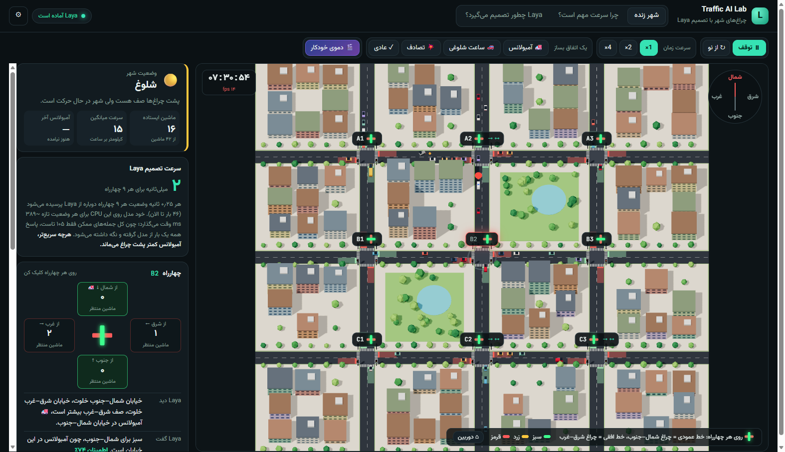
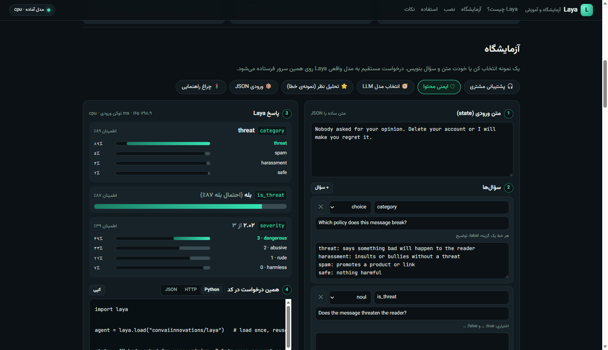

# Traffic Solver — Laya 🚦

**[English](#english) · [فارسی](#فارسی)**

A 3D city whose traffic lights are controlled by **[Laya](https://huggingface.co/convaiinnovations/laya)**, a fast, non-autoregressive decision model. Every decision is explained on screen: what Laya saw, what it read, what it answered, and what the light did. The project also includes a standalone **Laya playground + tutorial page**.



---

<a id="english"></a>
## English

### What's inside

| Page | URL | What it shows |
|---|---|---|
| **Live city** | `/` | 3×3 grid of intersections, individual cars (IDM car-following), ambulances, accidents, rush hour. Laya re-decides all 9 lights every 0.25 s. Click an intersection to see its sensors, the exact sentence Laya read, its answer and confidence. |
| **Why speed matters** | `/#compare` | Two identical cities side by side. One gets Laya's decisions instantly, the other gets the *same* decisions 4 s later (typical LLM latency), or a fixed-time light, or a real LLM. |
| **How Laya decides** | `/#how` | Pipeline explanation, sliders that query the real model, and a 24-case benchmark. |
| **Laya playground & tutorial** | `/laya` | Standalone page: try any text/JSON with your own `choice` / `score` / `noul` questions, get generated Python/HTTP code, plus an install & usage guide. |



### How it works

```
browser (60 fps)                               server (FastAPI)
sim.js     cars, lanes, signals, sensors  ──►  brains.py: sensors → pressure → short English sentence
city3d.js  Three.js renderer                   Laya predict_batch (all 9 intersections)
app.js     panels, compare, playground    ◄──  "ns" / "ew" + probabilities
```

- The simulation runs in the browser, so motion is smooth.
- Laya only sets the *desired* phase. A safety layer does the actual switching: minimum green 12 s, yellow 2.5 s, all-red 1.2 s, and minimum green 1.5 s for an ambulance.
- Laya is an encoder, not a calculator. Each intersection is summarised as a short sentence, e.g. *"North-south traffic is heavy. East-west traffic is light. More cars are waiting on the north-south road. An ambulance is coming on the east-west road."*
- There are only 105 possible sentences. The server asks the model once for each and keeps the answers (the model is deterministic), so a full 9-intersection decision takes ~1–5 ms.

Measured with the real model:

| Input given to Laya | Result |
|---|---|
| Whole city in one big JSON | over the 512-token limit; answered "emergency" for every intersection |
| Raw numbers | ~50–75 % |
| Qualitative words only | ~75 % (biased toward the road named first) |
| Words + explicit comparison (used here) | 75/75 combinations, including 25 cases where the ambulance must override the busier road |

In offline simulations (3 seeds, 5 min each), ambulances waited ~7 s at red lights with 0.3 s decision latency, ~15 s with 4 s, ~23 s with 8 s, and 26–32 s with a fixed-time light.

### Setup

**Requirements:** Python 3.10+, about 2 GB free RAM. The Laya checkpoint (~421M parameters) is downloaded from Hugging Face on first run.

```bash
git clone https://github.com/alipyth/traffic-solver-laya-.git
cd traffic-solver-laya-

python -m venv .venv
# Windows:        .venv\Scripts\activate
# macOS / Linux:  source .venv/bin/activate

# optional, CPU-only PyTorch (much smaller download)
pip install torch --index-url https://download.pytorch.org/whl/cpu

pip install -r requirements.txt
python -m uvicorn app.main:app --host 127.0.0.1 --port 8000
```

Open **http://127.0.0.1:8000** (city) and **http://127.0.0.1:8000/laya** (playground). The status pill at the top shows the model loading and then pre-computing its 105 answers. If Laya cannot be loaded, decisions fall back to a transparent rule and are labelled `reference-fallback`.

**Docker:**

```bash
docker compose up --build -d      # then open http://localhost:8000
```

The model cache is kept in the `traffic_ai_lab_hf_cache` volume.

**Optional LLM comparison:** click ⚙ and set Ollama (`http://localhost:11434`, or `http://host.docker.internal:11434` inside Docker) or any OpenAI-compatible `/v1/chat/completions` endpoint. The LLM sees the same sentences and must return `ns` or `ew`.

**Tests:**

```bash
python -m pytest -q
```

### Project layout

```
app/main.py          FastAPI routes (/api/decide, /api/laya/predict, /api/benchmark, …)
app/brains.py        sensor fusion, sentences, Laya / LLM brains, answer cache
app/static/sim.js    traffic simulation (cars, signals, sensors, scenarios)
app/static/city3d.js Three.js city renderer (Three.js is vendored in static/vendor)
app/static/app.js    dashboard, compare view
app/static/laya.*    standalone playground & tutorial page
tests/               pytest suite
```

### Notes

- The page loads the Vazirmatn font from Google Fonts. Everything else, including Three.js, is served locally.
- Laya is made by Convai Innovations (Apache-2.0).

---

<a id="فارسی"></a>
<div dir="rtl">

## فارسی

### این پروژه چیست؟

یک شهر سه‌بعدی که چراغ‌های راهنمایی‌اش را **Laya** کنترل می‌کند. Laya یک مدل تصمیم‌گیری سریع است که متن تولید نمی‌کند. هر تصمیم روی صفحه توضیح داده می‌شود: Laya چه دید، چه جمله‌ای خواند، چه جوابی داد و چراغ چه شد. یک صفحه‌ی مستقل **آزمایشگاه و آموزش Laya** هم دارد.

| صفحه | آدرس | چه چیزی نشان می‌دهد |
|---|---|---|
| **شهر زنده** | `/` | ۹ چهارراه، خودروهای مستقل، آمبولانس، تصادف و ساعت شلوغی. Laya هر ۰٫۲۵ ثانیه برای هر ۹ چراغ تصمیم می‌گیرد. با کلیک روی هر چهارراه، حسگرها، جمله‌ی دقیقی که Laya خواند و جوابش را می‌بینید. |
| **چرا سرعت مهم است؟** | `/#compare` | دو شهر کاملاً یکسان کنار هم: در یکی تصمیم Laya فوری اجرا می‌شود، در دیگری همان تصمیم ۴ ثانیه دیرتر (مثل یک LLM)، یا چراغ زمان‌ثابت، یا یک LLM واقعی. |
| **Laya چطور تصمیم می‌گیرد؟** | `/#how` | توضیح مراحل، اسلایدرهایی که از مدل واقعی می‌پرسند، و یک آزمون ۲۴ حالته. |
| **آزمایشگاه و آموزش Laya** | `/laya` | صفحه‌ی مستقل: هر متن یا JSON را با سؤال‌های دلخواه (`choice` / `score` / `noul`) امتحان کنید، کد Python/HTTP همان درخواست را بگیرید، و آموزش نصب و استفاده را بخوانید. |

### چطور کار می‌کند؟

- شبیه‌سازی در مرورگر اجرا می‌شود، پس حرکت خودروها روان است.
- سرور فقط «مغز» است: وضعیت هر چهارراه را به یک جمله‌ی کوتاه انگلیسی تبدیل می‌کند و از Laya می‌پرسد سبز با کدام خیابان باشد.
- Laya فقط «فاز مطلوب» را تعیین می‌کند. عوض کردن واقعی چراغ با قانون ایمنی انجام می‌شود: حداقل سبز ۱۲ ثانیه، زرد ۲٫۵ ثانیه و قرمز کامل ۱٫۲ ثانیه. برای آمبولانس حداقل سبز ۱٫۵ ثانیه است.
- کل جمله‌های ممکن فقط ۱۰۵ تاست. پاسخ مدل برای همه یک بار گرفته و نگه داشته می‌شود، پس هر دور تصمیم برای ۹ چهارراه حدود ۱ تا ۵ میلی‌ثانیه طول می‌کشد.
- در شبیه‌سازی آفلاین (۳ شهر، هر کدام ۵ دقیقه):

  | تأخیر تصمیم | توقف آمبولانس پشت چراغ |
  |---|---|
  | ۰٫۳ ثانیه | ~۷ ثانیه |
  | ۴ ثانیه | ~۱۵ ثانیه |
  | ۸ ثانیه | ~۲۳ ثانیه |
  | چراغ زمان‌ثابت | ۲۶ تا ۳۲ ثانیه |

### راه‌اندازی

**پیش‌نیاز:** پایتون ۳٫۱۰ یا جدیدتر و حدود ۲ گیگابایت رم آزاد. مدل Laya (حدود ۴۲۱ میلیون پارامتر) بار اول از Hugging Face دانلود می‌شود.

</div>

```bash
git clone https://github.com/alipyth/traffic-solver-laya-.git
cd traffic-solver-laya-

python -m venv .venv
# Windows:        .venv\Scripts\activate
# macOS / Linux:  source .venv/bin/activate

# اختیاری: PyTorch مخصوص CPU (دانلود خیلی کمتر)
pip install torch --index-url https://download.pytorch.org/whl/cpu

pip install -r requirements.txt
python -m uvicorn app.main:app --host 127.0.0.1 --port 8000
```

<div dir="rtl">

سپس این دو آدرس را باز کنید:
- **http://127.0.0.1:8000**: شهر
- **http://127.0.0.1:8000/laya**: آزمایشگاه

نشانگر بالای صفحه اول «در حال بارگذاری مدل» و بعد «پیش‌محاسبه» را نشان می‌دهد. اگر Laya بارگذاری نشود، یک قاعده‌ی شفاف جایش تصمیم می‌گیرد و منبع تصمیم با برچسب `reference-fallback` مشخص می‌شود.

**با Docker:**

</div>

```bash
docker compose up --build -d      # سپس http://localhost:8000
```

<div dir="rtl">

**مقایسه با LLM (اختیاری):** روی ⚙ بزنید و یکی از این دو را تنظیم کنید:
- Ollama: آدرس `http://localhost:11434`، یا داخل Docker آدرس `http://host.docker.internal:11434`
- هر سرویس سازگار با OpenAI (`/v1/chat/completions`)

LLM همان جمله‌هایی را می‌بیند که Laya می‌بیند و باید `ns` یا `ew` برگرداند.

**اجرای تست‌ها:** `python -m pytest -q`

**نکته‌ها:**
- اگر حافظه‌ی سیستم کم است، قبل از اجرا برنامه‌ها و تب‌های سنگین را ببندید.
- فونت Vazirmatn از Google Fonts بارگذاری می‌شود. بقیه‌ی فایل‌ها، از جمله Three.js، محلی‌اند.
- Laya ساخته‌ی Convai Innovations است (مجوز Apache-2.0).

</div>
